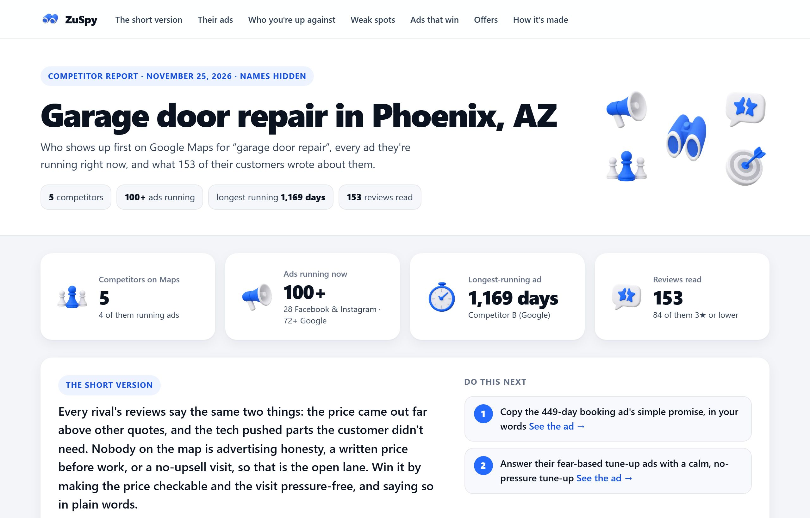
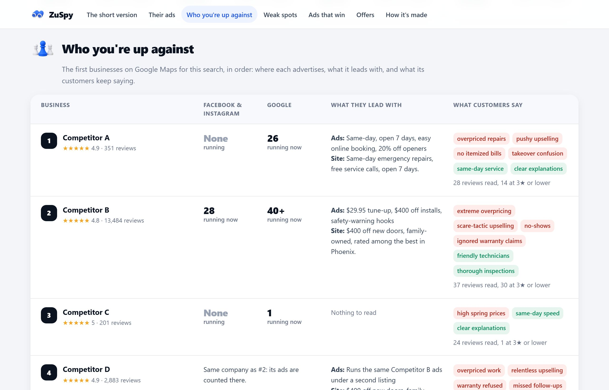
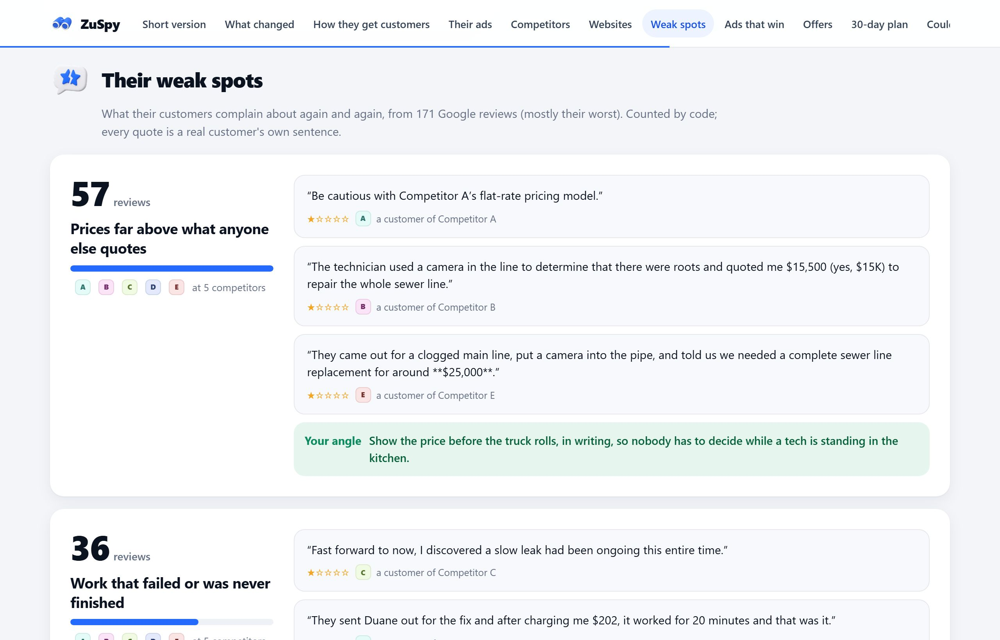

<p align="center"></p>

# ZuSpy

**See every ad your local competitors are running, what their customers complain about, and the ads that win those
customers over. Then keep watching them.** Free and open source. You hand it to Claude and Claude sets it up.

Type what you sell and your town. In about two minutes ZuSpy:

- finds the businesses that beat you on **Google Maps** for that search,
- pulls **every ad they're running right now** on Facebook, Instagram and Google (pictures and videos saved, longest
  running first, because nobody keeps paying for an ad that doesn't work),
- reads their **worst Google reviews** and counts what their customers complain about, with real quotes,
- and writes **ads and offers that win those customers**, each with what you must really do for it to be honest.

> **Don't want to set anything up?** ZuSpy is the open-source version of **Competitor Spy** in
> [Zuops](https://zuops.com/features/competitor-spy?utm_source=zuspy&utm_medium=github). There it's one click, no API
> keys, it checks your competitors every week and tells you what changed, and any of their ads becomes yours with
> Copy or Remix.

## Give it to your Claude

Open [Claude Code](https://claude.com/claude-code) in any folder and paste this (put in what you sell and where):

```text
Set up ZuSpy from https://github.com/zutrue/zuspy and run a competitor report for me. I sell garage door repair in Phoenix, AZ.
```

Claude takes it from there, one step at a time:

1. Checks you have Node 18+, clones ZuSpy and installs it.
2. Opens a **setup page in your browser** where you paste your keys, test each one and save. Your keys go straight from
   that page to a private file on your computer. They never pass through the chat.
3. Tells you what the report costs (a few cents) and runs it.
4. Opens the report and walks you through it: who's advertising, their longest-running ad, their biggest weak spot,
   and the ad to run first.

You only need one account: **[DataForSEO](https://app.dataforseo.com/register)** (pay as you go, a report uses about
4 cents of it). The AI part runs on your Claude Code plan (Claude reads a ~100 KB brief and writes the analysis
itself, a few minutes and roughly 200k tokens), or on an API key if you'd rather (about 10 cents, under a minute).

<details>
<summary>Or install it as a Claude Code plugin (works in every folder)</summary>

```text
/plugin marketplace add zutrue/zuspy
/plugin install zuspy@zuspy
```

Then ask Claude to "spy on my competitors" or "set up ZuSpy". To use an Anthropic API key in plugin mode, run
`npm install` once in the plugin's folder (Claude will tell you where).

</details>

<details>
<summary>Or run it yourself in a terminal</summary>

```bash
git clone https://github.com/zutrue/zuspy
cd zuspy
npm install
node bin/zuspy.mjs setup                                     # paste and test your keys in the browser
node bin/zuspy.mjs spy "garage door repair" "Phoenix, AZ"    # about 2 minutes
```

Without an AI key, the run stops after collecting and writes `prompt.md` for Claude Code (or any AI) to answer;
`zuspy finish <folder>` turns the answer into the report.

</details>

## What you get

One page that opens in any browser, with every picture saved next to it. This is a real run (garage door repair in
Phoenix, AZ) with the business names hidden and their ads blurred; your own report shows everything.



**Their ads.** Every ad they're running on Facebook, Instagram and Google, filtered by competitor, place and kind. Each
one shows how long it has run, how many versions they run, its words and button. Click to see it big, play the video,
copy its words or open it in Meta's Ad Library or Google's Ads Transparency Center. "Others in this market" adds the
businesses advertising for the same search that aren't in the Maps top 5.


**Who you're up against.** The Maps top 5 in order: rating, how many ads each runs where, what their ads and their
website lead with, the ad trackers on their site, and what their customers keep saying.



**Their weak spots.** What their customers complain about again and again, counted across all of them, with real
quotes, and the angle that wins those customers.



**Ads that win their customers, and offers to test.** Written for you, shown the way they'd look in the feed. None
names a competitor, and each says what you must really do for it to be honest ("Only run it if you itemize every bill").


You also get `report.md` (paste it anywhere or hand it to an AI) and `report.json` (all of it, as data).
`zuspy rebuild <folder> --anonymous` makes a copy with every business name, website and phone number hidden, for
sharing or posting.

## Keep watching them

```bash
zuspy watch halvorsendoors.com --name "Halvorsen Garage Doors" --town "Phoenix, AZ"
```

The first check takes their snapshot (ads, the offers and headline on their site, the tools in its code, the pages
their ads send people to, their sitemap, open jobs, Google rating) and reads **their last year** from the web archive
and certificate records: when they changed their headline, ran a new offer or put up a new site. Run the same command
next week (or `zuspy watch --all` from cron or Task Scheduler) and you get what changed, like this:

```text
4 changes at Halvorsen Garage Doors since 2026-11-18:
  * New offer on their website: Same Day Garage Door Repair
  * Changed the headline on their home page: "Garage Door Repair You Can Trust" -> "Fast, Honest Repair & Installation"
  * New video ad on Facebook and Instagram
  * New ad on Facebook and Instagram
```

Every change is found by code, never written by an AI, and a part that couldn't be read says nothing: "stopped
advertising" always means they stopped. A check costs about half a cent.

## What it costs

Measured on real runs in November 2026:

| | Cost |
| --- | --- |
| DataForSEO (Maps, 40 reviews per competitor, Google ads) | about $0.03-0.05 a report |
| The AI, run by Claude Code (no key) | your Claude Code plan (180k-230k tokens a report, measured on 3 and 5 competitors) |
| The AI, with an Anthropic, OpenRouter or Zurelay key (Claude Sonnet 5.5) | about $0.09-0.11 a report |
| Facebook and Instagram ads | free in your own Chrome or Edge (or a few Firecrawl credits) |
| A `watch` check | about $0.005 |

Real reports: garage door repair in Phoenix (5 competitors, 100+ ads running, 153 reviews read) took 1 minute 53
seconds and cost $0.15 with an API key. Roof repair in Tampa (4 competitors, 122 reviews) cost $0.12. Plumbing in
Denver (5 competitors, 48 ads, 183 reviews), set up from scratch by a fresh Claude Code with only the prompt above:
44 seconds of collecting, $0.04 of DataForSEO, and Claude wrote the analysis.

## How it works, and why you can trust it

1. **Maps.** A live Google Maps search for your service and town (DataForSEO). The first listings that aren't you,
   with a few reviews, are your competitors. Two listings with one website are one company.
2. **Their ads**, for each competitor at once: Meta's Ad Library searched by their name (then their domain), and
   Google's Ads Transparency Center by their domain. Only ads that are really theirs count: the ad's link goes to their
   site, or the page is named exactly like them (a franchise name brings back every location; those are left out).
   Job posts and Marketplace listings are left out. Pictures and videos are saved, because the libraries' links expire
   within hours. Google's search ads come as pictures; a small model copies their words.
3. **Their reviews:** each competitor's 30 lowest-rated and 10 most relevant Google reviews.
4. **The analysis:** the AI reads it all and writes the patterns, ads and offers. Then code checks every part of the
   answer:
   - **counts are counted by code** from the review ids the AI cites, never taken from the AI;
   - **every quote is rebuilt from the review's own sentence**, so nothing is reworded or made up;
   - **an ad or offer that names a competitor is dropped**;
   - an ad library that couldn't be read is marked "couldn't read", **never "no ads"**.

### Better than a teardown prompt

| | Asking an AI to "reverse engineer my competitor's marketing" | ZuSpy |
| --- | --- | --- |
| Their ads | guessed, or you go look | every ad running now, saved, with how long each has run |
| Their customers' complaints | summarized from memory | counted from their real reviews, with real quotes |
| Who your competitors are | who you name | who actually beats you on Google Maps today |
| Numbers | written by the AI | counted by code |
| Time | an afternoon of back and forth | about two minutes |
| Next month | start over | `zuspy watch`: what changed, dated |

## Your keys and your data

- `zuspy setup` serves its page on `127.0.0.1` only, with a one-time code in the link, refuses any other website's
  requests, and closes when you save. Keys are saved in `~/.zuspy/.env` (readable only by you), outside every project
  and repo. Claude never sees them.
- ZuSpy reads public pages only: Google Maps, public Google reviews, Meta's Ad Library, Google's Ads Transparency
  Center, the web archive and the competitors' public websites. It never logs in anywhere, never contacts a
  competitor and never posts anything.
- The hidden browser that reads Meta's Ad Library starts with a new, empty profile each time: your logins, cookies and
  history are never used.
- Reports stay on your computer. The only things sent anywhere are the searches to DataForSEO (and Firecrawl if you
  use it) and the analysis prompt to the AI you picked.

## Limits, said plainly

- **US businesses.** Maps searches, reviews and the ad libraries are read for the US.
- **No ad spend or results.** Nobody outside a company can see those; ZuSpy shows how long an ad has run instead.
- **No TikTok ads.** TikTok has no public ad library for US advertisers; ZuSpy reports the TikTok pixel when it's on
  their site.
- A business that runs ads under a Facebook page with a different name can be missed (ZuSpy also searches their
  domain to catch most of these).
- DataForSEO is the one account you need. A Firecrawl key is optional (a backup for reading Meta's Ad Library).

## Commands

In a clone, `zuspy` is `node bin/zuspy.mjs` (or run `npm link` once to get the `zuspy` command everywhere).

| Command | What it does |
| --- | --- |
| `zuspy setup` | A page in your browser to paste, test and save your keys |
| `zuspy doctor` | What's ready and what's missing |
| `zuspy spy "<service>" "<town, ST>" [--me "<your business>"] [--rivals 5] [--no-reviews] [--open]` | The report |
| `zuspy finish <folder>` | Turn Claude Code's `analysis.json` into the report (when no AI key is set) |
| `zuspy watch <website> [--name "<name>"] [--town "<town, ST>"]` | Check one company; run it again to see what changed |
| `zuspy watch` · `zuspy watch --all` · `zuspy watch --remove <host>` | List, check all, stop watching |
| `zuspy rebuild <folder> [--anonymous]` | Draw the page again; `--anonymous` hides every business name |
| `zuspy list` · `zuspy open <folder>` | Your reports |

Settings (all optional, in `.env` or `~/.zuspy/.env`) are listed in [`.env.example`](.env.example): pick the AI
(`ZUSPY_AI`), the model (`ZUSPY_MODEL`), where reports go (`ZUSPY_DIR`), your browser's path (`ZUSPY_BROWSER`).

## Credits

ZuSpy is the open-source version of Competitor Spy in **[Zuops](https://zuops.com/?utm_source=zuspy&utm_medium=github)**,
the marketing platform for local businesses and the agencies that serve them. The rules that pick the competitors and
their ads, the prompt and the checks on the AI's answer are the same ones Zuops runs.

Also from us: [Zuverse](https://github.com/zutrue/zuverse) (remake any video ad) and
[Zuswarm](https://github.com/zutrue/zuswarm) (an AI focus group for your ads).

MIT licensed. Contributions welcome: `npm test` runs the tests.
