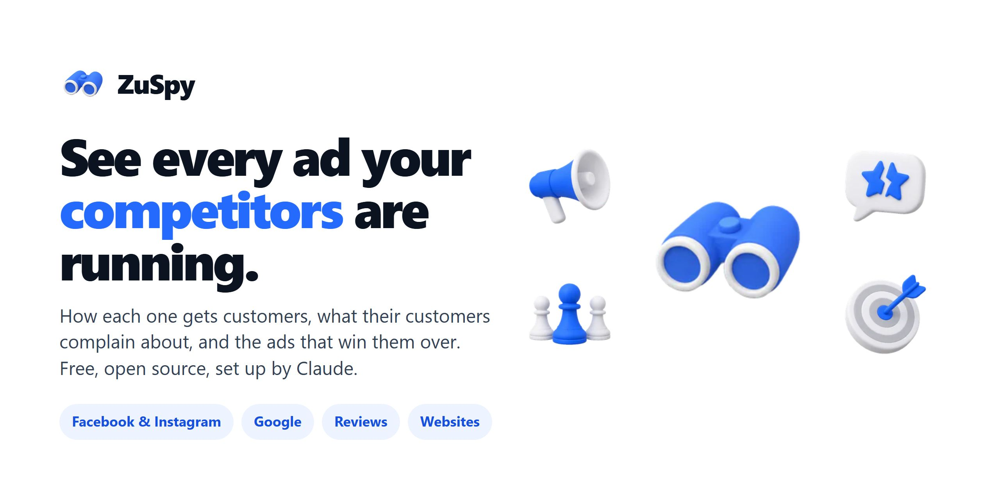
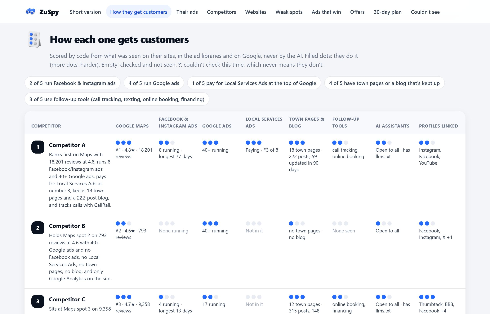
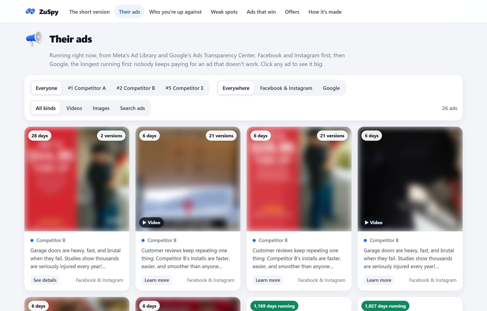
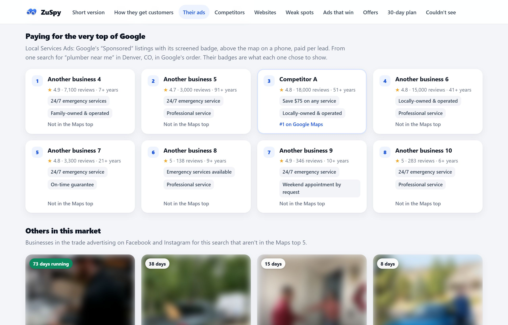
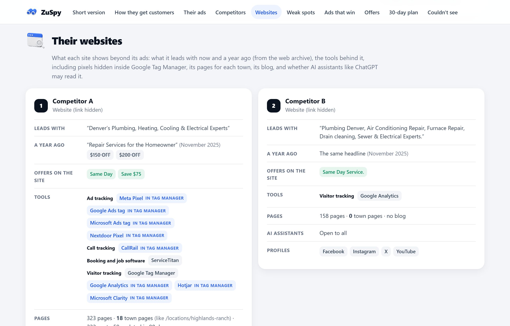
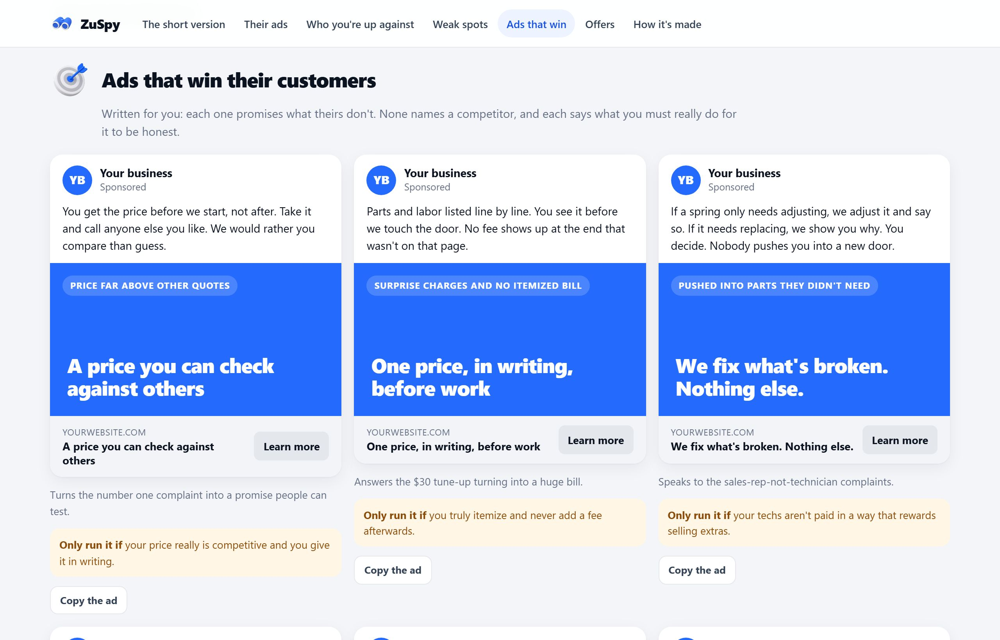
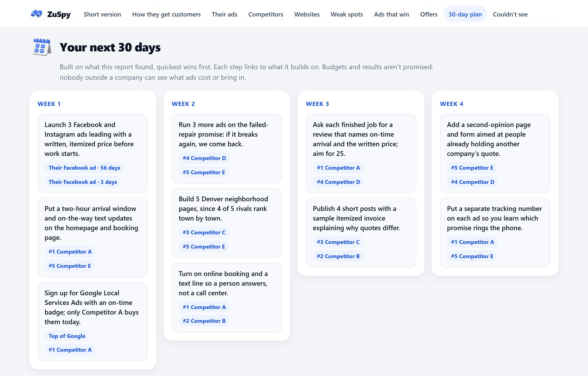
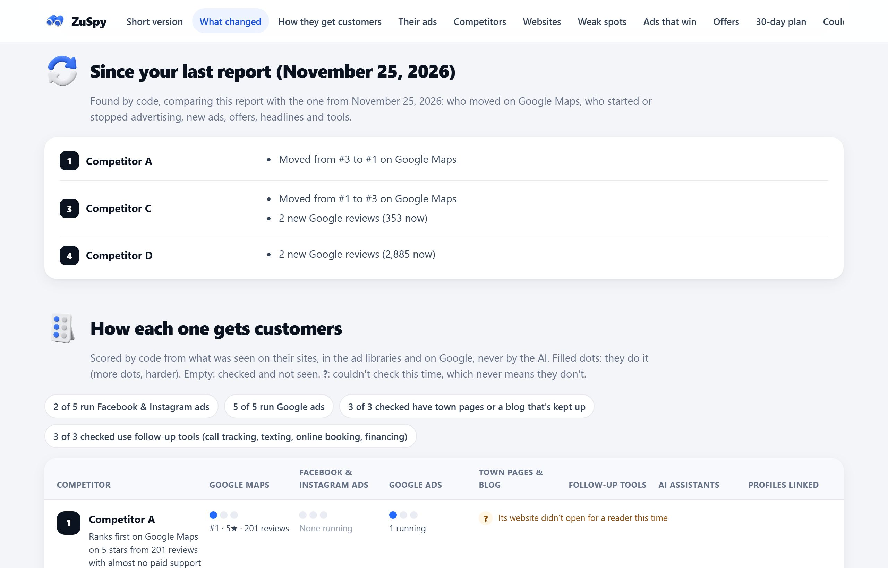

<p align="center"></p>

# ZuSpy

**See how every local competitor gets customers: every ad they're running, who pays for the top of Google, what
their websites hide, what their customers complain about, and the ads and plan that win those customers over. Then
keep watching them.** Free and open source. You hand it to Claude and Claude sets it up.

Type what you sell and your town. In about two minutes ZuSpy:

- finds the businesses that beat you on **Google Maps** for that search, and scores **how each one gets customers**,
  channel by channel, from what it actually saw (never guessed by an AI),
- pulls **every ad they're running right now** on Facebook, Instagram and Google (pictures and videos saved, longest
  running first, because nobody keeps paying for an ad that doesn't work), and **who pays for the very top of Google**
  (Local Services Ads, with the badge each one chose),
- reads **their websites**: the pixels they hide inside Google Tag Manager, their call tracking, booking and financing
  tools, how many **pages for each town** they've built, whether **ChatGPT and other AI assistants** may read them, and
  what their home page said **a year ago**,
- reads their **worst Google reviews** and counts what their customers complain about, with real quotes,
- writes **ads and offers that win those customers**, each with what you must really do for it to be honest, and a
  **30-day plan**, every step linked to what it builds on,
- and next time you run it, tells you **what changed** in your market.

> **Don't want to set anything up?** ZuSpy is the open-source version of **Competitor Spy** in
> [Zuops](https://zuops.com/features/competitor-spy?utm_source=zuspy&utm_medium=github). There it's one click, no API
> keys, it checks your competitors every week and tells you what changed, and any of their ads becomes yours with
> Copy or Remix.

## Give it to your Claude

Open [Claude Code](https://claude.com/claude-code) in any folder and paste this (put in what you sell and where):

```text
Set up ZuSpy from https://github.com/zutrue/zuspy and run a competitor report for me. I sell garage door repair in Phoenix, AZ.
```

Claude takes it from there, one step at a time:

1. Checks you have Node 18+, clones ZuSpy and installs it.
2. Opens a **setup page in your browser** where you paste your keys, test each one and save. Your keys go straight from
   that page to a private file on your computer. They never pass through the chat.
3. Tells you what the report costs (a few cents) and runs it.
4. Opens the report and walks you through it: who's advertising, their longest-running ad, who pays for the top of
   Google, their biggest weak spot, the ad to run first, and week one of your plan.

You only need one account: **[DataForSEO](https://app.dataforseo.com/register)** (pay as you go, a report uses about
5 cents of it). The writing runs on your **Claude plan**: when Claude Code's `claude` command is installed, ZuSpy runs it
in the background with no tools and no API key, so your chat stays short (about 50k tokens a report). Without it,
Claude reads the brief in the chat and writes the analysis itself. Or use an API key (about 12 cents, under a minute).

<details>
<summary>Or install it as a Claude Code plugin (works in every folder)</summary>

```text
/plugin marketplace add zutrue/zuspy
/plugin install zuspy@zuspy
```

Then ask Claude to "spy on my competitors" or "set up ZuSpy". To use an Anthropic API key in plugin mode, run
`npm install` once in the plugin's folder (Claude will tell you where).

</details>

<details>
<summary>Or run it yourself in a terminal</summary>

```bash
git clone https://github.com/zutrue/zuspy
cd zuspy
npm install
node bin/zuspy.mjs setup                                     # paste and test your keys in the browser
node bin/zuspy.mjs spy "garage door repair" "Phoenix, AZ"    # about 2 minutes
```

With Claude Code installed and signed in, that's all: it writes the analysis on your plan. With no AI at all, the run
stops after collecting and writes `prompt.md` for any AI to answer; `zuspy finish <folder>` turns the answer into the
report.

</details>

## What you get

One page that opens in any browser, with every picture saved next to it. These are real runs (garage door repair in
Phoenix, plumbing in Denver) with the business names hidden and their ads blurred; your own report shows everything.


**How each one gets customers.** Every competitor, channel by channel: Google Maps, Facebook and Instagram ads, Google
ads, Local Services Ads, town pages and blog, follow-up tools, AI assistants, profiles. Scored by code from what was
seen. A channel it couldn't check shows a **?**, never "no": unknown isn't "they don't do it". Under each name, one line
on how that business really gets its customers.



**Their ads.** Every ad they're running on Facebook, Instagram and Google, filtered by competitor, place and kind. Each
one shows how long it has run, how many versions they run, its words and button. Click to see it big, play the video,
copy its words or open it in Meta's Ad Library or Google's Ads Transparency Center. "Others in this market" adds the
businesses advertising for the same search that aren't in the Maps top 5.



**Paying for the very top of Google.** Google's Local Services Ads ("Sponsored", with Google's screened badge, paid per
lead) in Google's order, with each business's rating, years in business and the badges it picked ("Save $75 on any
service", "On-time guarantee"). Your competitors among them are marked.



**Who you're up against.** The Maps top 5 in order: rating, how many ads each runs where, what their ads and their
website lead with, and what their customers keep saying.


**Their websites.** What each site leads with now and **a year ago** (from the web archive, with the offers it has
since dropped), the tools behind it, including the **pixels hidden inside Google Tag Manager** that a look at the page
source misses, its **pages for each town**, its blog, whether **AI assistants** may read it, the profiles it links,
and a different phone number than Google's (a tracking number).



**Their weak spots.** What their customers complain about again and again, counted across all of them, with real
quotes, and the angle that wins those customers.


**Ads that win their customers, and offers to test.** Written for you, shown the way they'd look in the feed. None
names a competitor, and each says what you must really do for it to be honest ("Only run it if you itemize every bill").



**Your next 30 days.** Week by week, quickest wins first. Every step links to what it builds on (their ad, their site,
the top of Google), and none promises a budget or results nobody outside a company can know.



**Since your last report.** Run the same search again next month and the report starts with what changed: who moved on
Google Maps, who started or stopped advertising, new ads, new offers and headlines on their sites, new tools, more town
pages. Found by code, comparing the two reports.



It ends with **what ZuSpy couldn't see** (an ad library that didn't answer, Local Services Ads Google didn't show this
time, TikTok and Nextdoor ads, ad spend) and a link to check each one yourself.

You also get `report.md` (paste it anywhere or hand it to an AI) and `report.json` (all of it, as data).
`zuspy rebuild <folder> --anonymous` makes a copy with every business name, website and phone number hidden, for
sharing or posting.

## Keep watching one of them

```bash
zuspy watch halvorsendoors.com --name "Halvorsen Garage Doors" --town "Phoenix, AZ"
```

The first check takes their snapshot (ads, the offers and headline on their site, the tools in its code and its Tag
Manager, the pages their ads send people to, their sitemap, open jobs, Google rating) and reads **their last year** from
the web archive and certificate records: when they changed their headline, ran a new offer or put up a new site. Run
the same command next week (or `zuspy watch --all` from cron or Task Scheduler) and you get what changed, like this:

```text
4 changes at Halvorsen Garage Doors since 2026-11-18:
  * New offer on their website: Same Day Garage Door Repair
  * Changed the headline on their home page: "Garage Door Repair You Can Trust" -> "Fast, Honest Repair & Installation"
  * New video ad on Facebook and Instagram
  * New ad on Facebook and Instagram
```

Every change is found by code, never written by an AI, and a part that couldn't be read says nothing: "stopped
advertising" always means they stopped. A check costs about half a cent.

## What it costs

Measured on real runs in November 2026:

| | Cost |
| --- | --- |
| DataForSEO (Maps, 40 reviews per competitor, Google ads, Local Services Ads) | about $0.04-0.05 a report |
| The AI, by Claude Code on your plan (no key) | about 50k tokens a report run in the background (47k measured in Denver); about 200k if Claude reads the brief in the chat instead |
| The AI, with an Anthropic, OpenRouter or Zurelay key (Claude Sonnet 5.5) | about $0.12 a report |
| Facebook and Instagram ads | free in your own Chrome or Edge (or a few Firecrawl credits) |
| Their websites, Tag Manager, robots.txt, sitemaps, the web archive | free |
| A `watch` check | about $0.005 |

Real reports: garage door repair in Phoenix (5 competitors, 100+ ads running, 153 reviews read) cost $0.17 with an
API key. Plumbing in Denver (5 competitors, 42 ads, 171 reviews, 8 businesses in Local Services
Ads) cost $0.04 of DataForSEO, with Claude Code writing it on the plan. Roof repair in Tampa (4 competitors, 122
reviews) cost $0.12.

## How it works, and why you can trust it

1. **Maps.** A live Google Maps search for your service and town (DataForSEO). The first listings that aren't you,
   with a few reviews, are your competitors. Two listings with one website are one company.
2. **Their ads**, for each competitor at once: Meta's Ad Library searched by their name (then their domain), and
   Google's Ads Transparency Center by their domain. Only ads that are really theirs count: the ad's link goes to their
   site, or the page is named exactly like them (a franchise name brings back every location; those are left out).
   Job posts and Marketplace listings are left out. Pictures and videos are saved, because the libraries' links expire
   within hours. Google's search ads come as pictures; a small model copies their words.
3. **The top of Google**: a live Google search in your town for Local Services Ads. Google rotates them, so ZuSpy
   searches up to four times and says plainly when they didn't show.
4. **Their websites**: each home page, the Google Tag Manager containers it loads (where most local businesses keep
   their Meta, Google, Microsoft and Nextdoor pixels and their call tracking), robots.txt and llms.txt, their sitemaps
   (town pages, the blog) and the web archive's copy from about a year ago.
5. **Their reviews:** each competitor's 30 lowest-rated and 10 most relevant Google reviews.
6. **The scorecard**, by code: each channel is "doing it" (one to three dots), "checked, not seen", or "couldn't
   check". The AI explains it and may never contradict it.
7. **The analysis:** the AI reads it all and writes the patterns, ads, offers and the 30-day plan. Then code checks
   every part of the answer:
   - **counts are counted by code** from the review ids the AI cites, never taken from the AI;
   - **every quote is rebuilt from the review's own sentence**, so nothing is reworded or made up;
   - **an ad or offer that names a competitor is dropped**, and so is a plan step that promises a budget or ad results;
   - plan steps link only to ads, competitors and findings that exist;
   - an ad library or website that couldn't be read is marked "couldn't read", **never "none"**.
8. **What changed**: when you've run the same search before, code compares the two reports.

### Better than a teardown prompt

| | Asking an AI to "reverse engineer my competitor's marketing" | ZuSpy |
| --- | --- | --- |
| Their ads | guessed, or you go look | every ad running now, saved, with how long each has run |
| Their tracking and tools | missed: most pixels live inside Google Tag Manager | read from their Tag Manager containers |
| Who pays for the top of Google | unknown | Google's Local Services Ads, in order, with their badges |
| Their customers' complaints | summarized from memory | counted from their real reviews, with real quotes |
| Who your competitors are | who you name | who actually beats you on Google Maps today |
| Numbers | written by the AI | counted by code |
| What it couldn't see | silently filled in | listed, with a link to check it yourself |
| Time | an afternoon of back and forth | about two minutes |
| Next month | start over | run it again: what changed, by code |

## Your keys and your data

- `zuspy setup` serves its page on `127.0.0.1` only, with a one-time code in the link, refuses any other website's
  requests, and closes when you save. Keys are saved in `~/.zuspy/.env` (readable only by you), outside every project
  and repo. Claude never sees them.
- When Claude Code writes the analysis, ZuSpy runs it with no tools (it can only read the brief and answer), in an
  empty folder, without your MCP servers, hooks or settings, and with any API key taken out of its environment.
- ZuSpy reads public pages only: Google Maps, public Google reviews, Meta's Ad Library, Google's Ads Transparency
  Center, Google search, the web archive and the competitors' public websites. It never logs in anywhere, never
  contacts a competitor and never posts anything.
- The hidden browser that reads Meta's Ad Library starts with a new, empty profile each time: your logins, cookies and
  history are never used.
- Reports stay on your computer. The only things sent anywhere are the searches to DataForSEO (and Firecrawl if you
  use it) and the analysis prompt to the AI you picked.

## Limits, said plainly

- **US businesses.** Maps searches, reviews, Google searches and the ad libraries are read for the US.
- **No ad spend or results.** Nobody outside a company can see those; ZuSpy shows how long an ad has run instead.
- **Local Services Ads rotate.** Google shows them to about one search in four; when none show, the report says so.
- **No TikTok or Nextdoor ads.** Neither has a public ad library for US advertisers; ZuSpy reports their pixels when
  they're on the site (or inside its Tag Manager).
- A website behind a bot check can't be read; the report marks it unknown and links it.
- A business that runs ads under a Facebook page with a different name can be missed (ZuSpy also searches their
  domain to catch most of these).
- DataForSEO is the one account you need. A Firecrawl key is optional (a backup for reading Meta's Ad Library).

## Commands

In a clone, `zuspy` is `node bin/zuspy.mjs` (or run `npm link` once to get the `zuspy` command everywhere).

| Command | What it does |
| --- | --- |
| `zuspy setup` | A page in your browser to paste, test and save your keys |
| `zuspy doctor` | What's ready and what's missing |
| `zuspy spy "<service>" "<town, ST>" [--me "<your business>"] [--rivals 5] [--no-reviews] [--open]` | The report (run it again later on the same search to see what changed) |
| `zuspy finish <folder>` | Turn an `analysis.json` written from `prompt.md` into the report |
| `zuspy watch <website> [--name "<name>"] [--town "<town, ST>"]` | Check one company; run it again to see what changed |
| `zuspy watch` · `zuspy watch --all` · `zuspy watch --remove <host>` | List, check all, stop watching |
| `zuspy rebuild <folder> [--anonymous]` | Draw the page again; `--anonymous` hides every business name |
| `zuspy list` · `zuspy open <folder>` | Your reports |

Settings (all optional, in `.env` or `~/.zuspy/.env`) are listed in [`.env.example`](.env.example): pick the AI
(`ZUSPY_AI`: `anthropic`, `openrouter`, `zurelay`, `openai`, `claude-cli`, `manual`), the model (`ZUSPY_MODEL`), your
`claude` command (`ZUSPY_CLAUDE_BIN`), where reports go (`ZUSPY_DIR`), your browser's path (`ZUSPY_BROWSER`).

## Credits

ZuSpy is the open-source version of Competitor Spy in **[Zuops](https://zuops.com/?utm_source=zuspy&utm_medium=github)**,
the marketing platform for local businesses and the agencies that serve them. The rules that pick the competitors and
their ads, the prompt and the checks on the AI's answer are the same ones Zuops runs.

Several ideas come from **[REM, Reverse Engineer Marketing](https://github.com/dansugc/reverse-engineer-marketing)** by
DansUGC (MIT), rebuilt here for local businesses: reading pixels inside Google Tag Manager, a channel scorecard decided
by code, listing the unknowns with a way to check them, comparing two runs, a 30-day playbook, and running Claude Code
headless on your plan.

Also from us: [Zuverse](https://github.com/zutrue/zuverse) (remake any video ad) and
[Zuswarm](https://github.com/zutrue/zuswarm) (an AI focus group for your ads).

MIT licensed. Contributions welcome: `npm test` runs the tests.
